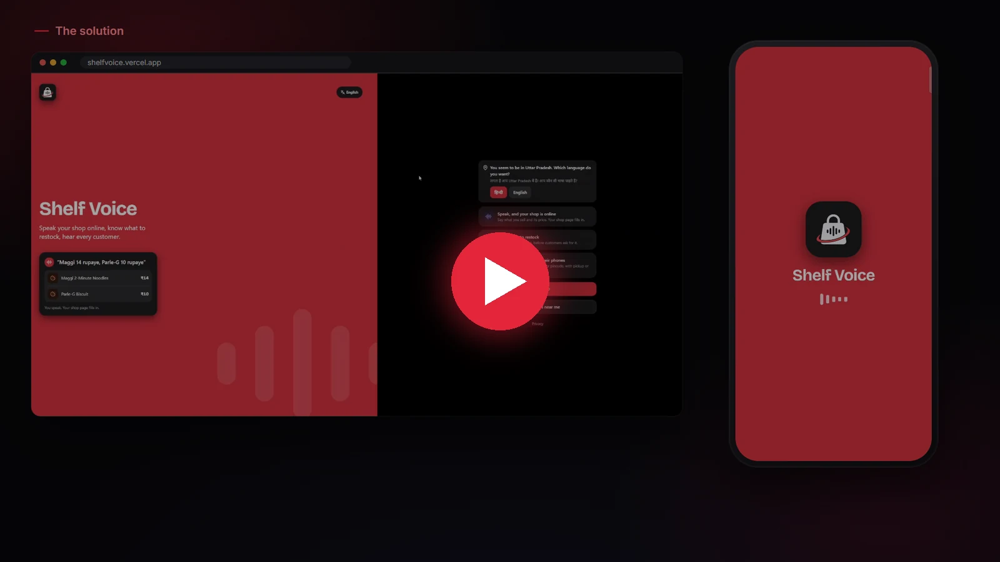
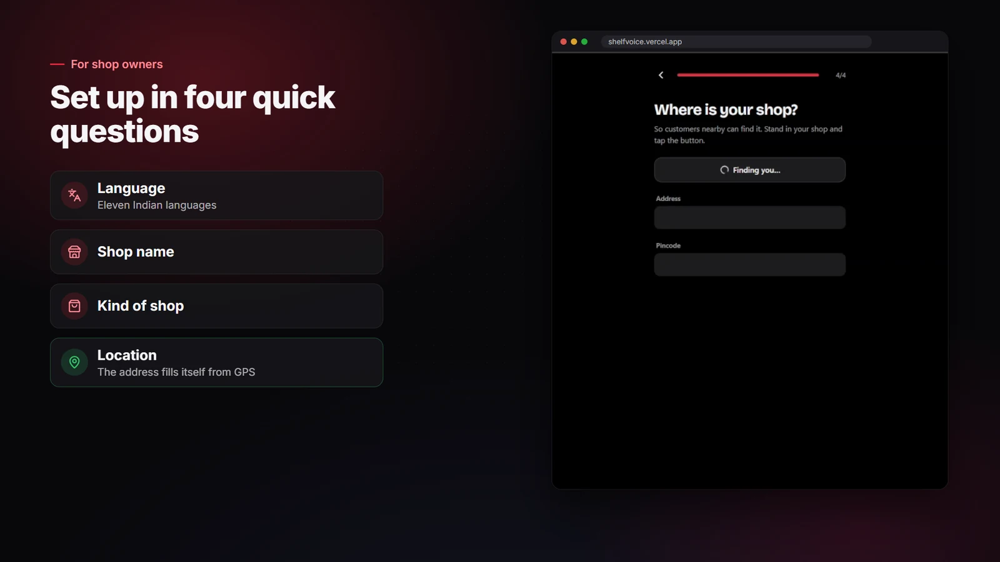
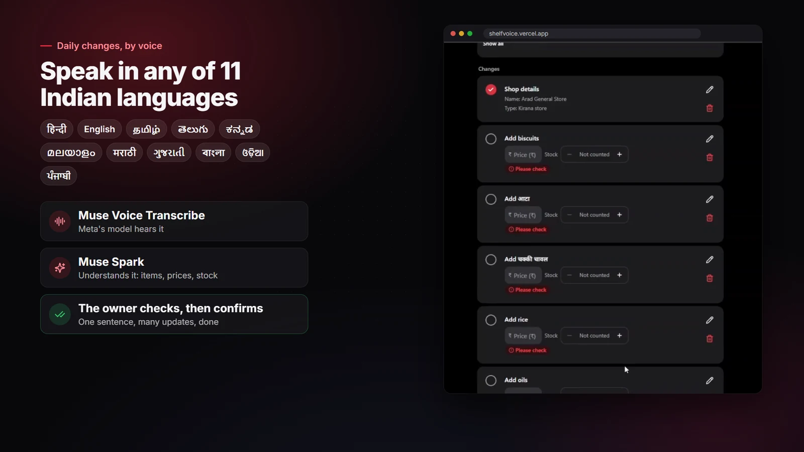
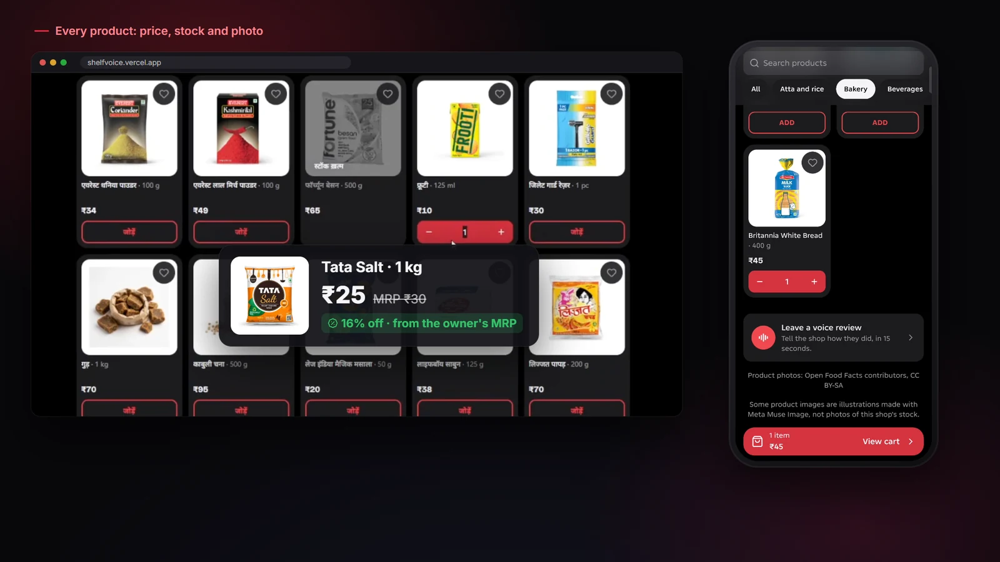
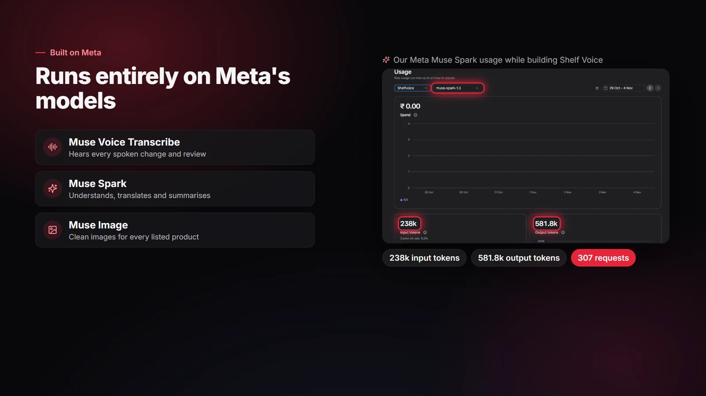
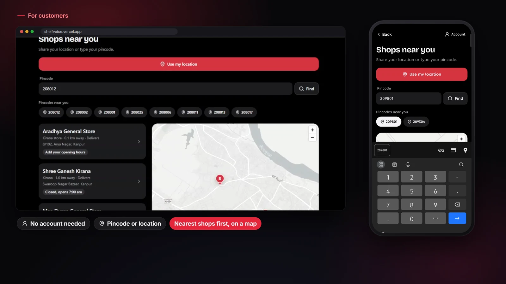
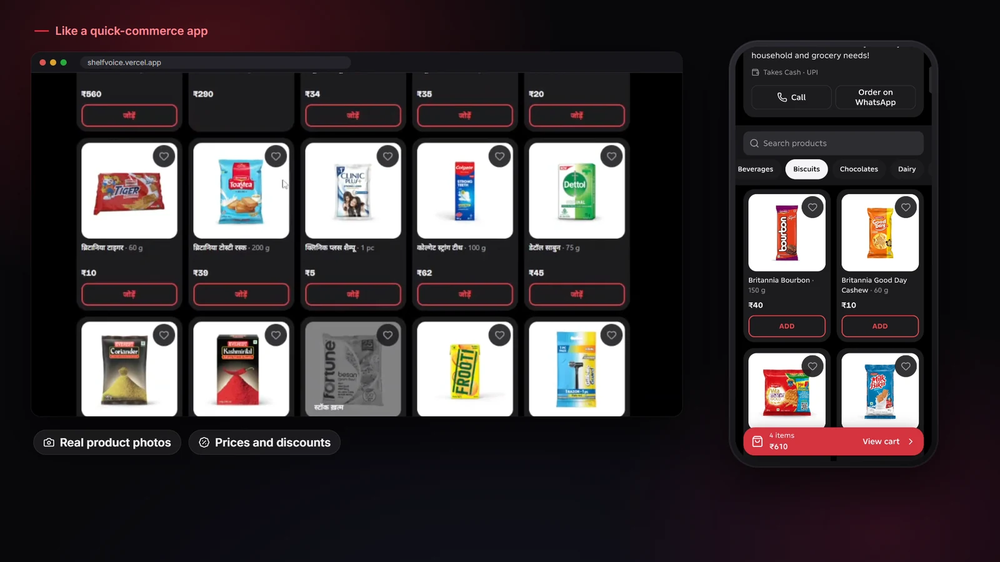
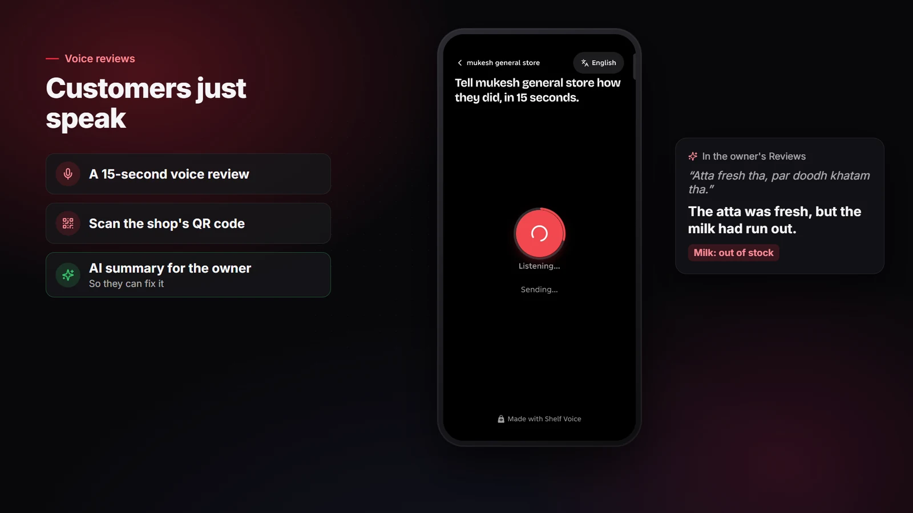

<p align="center">
  <picture>
    <source media="(prefers-color-scheme: dark)" srcset="brand/logo/shelf-voice-logo-dark.svg">
    
  </picture>
</p>

<h1 align="center">Shelf Voice</h1>

<p align="center">
  Your kirana, online. Just by speaking.
</p>

<p align="center">
  <a href="https://shelfvoice.vercel.app"><b>Open the app</b></a>
  &nbsp;·&nbsp;
  <a href="docs/media/shelf-voice-demo.mp4"><b>Watch the 2-minute demo</b></a>
  &nbsp;·&nbsp;
  <a href="https://shelfvoice.vercel.app/privacy">Privacy</a>
</p>

<p align="center">
  
  
  
  
  
</p>

<p align="center">
  <a href="docs/media/shelf-voice-demo.mp4">
    
  </a>
</p>

Shelf Voice gives a kirana shop owner an online shop, a restock list and their customers' feedback, and all of it works by voice. The owner says "Maggi 14 rupaye, Parle-G 10 rupaye" in Hindi, English or a mix, and the shop page fills itself in. Customers nearby find the shop on a map and order from it the way they would on a quick-commerce app.

Shelf Voice was built for the Meta Global AI Developer Hackathon (Oct 26 to Nov 4, 2026), and every AI feature in it runs on Meta's Muse models.

## The problem

India has more than a crore kirana shops, and most of them run on the owner's memory and a notebook. The owner is behind the counter all day, often speaks Hindi or another regional language, and has no time to type a thousand products into an app. So three things keep going wrong:

1. The shop has no page online, and customers drift to quick-commerce apps.
2. The owner finds out an item ran out when a customer asks for it.
3. Customers who leave unhappy never say why.

Most shop software expects the owner to sit down and type, usually in English. At a busy counter that doesn't happen.

## What Shelf Voice does

### For shop owners

<table>
  <tr>
    <td width="50%"></td>
    <td width="50%"></td>
  </tr>
  <tr>
    <td>Setup is four questions in the owner's own language. Tap "Use my location" and the address fills itself in from the phone's GPS.</td>
    <td>Speak changes in Hindi, English or nine other Indian languages. One sentence can carry many updates, and the owner checks each one before it is saved.</td>
  </tr>
  <tr>
    <td></td>
    <td></td>
  </tr>
  <tr>
    <td>Every product gets a price, a stock count and a clean photo. When the owner sells below the MRP printed on the pack, customers see the discount.</td>
    <td>Speech, product understanding, translation, review summaries and product images all run on Meta's models. The screenshot is the real Muse Spark usage from building the app.</td>
  </tr>
</table>

A kirana stocks hundreds of items, so speaking isn't the only way in. The owner can tick products from a ready-made list for their kind of shop, photograph a supplier's bill, photograph a shelf, scan barcodes, or upload the Excel or CSV export from their billing app.

Sales are logged by voice too ("do Maggi bike"). The restock list then says what to order, how much, and why, with the items closest to running out at the top.

Nothing the AI suggests is saved until the owner confirms it on a check screen, and any confirmed change can be undone for 10 seconds.

### For customers

<table>
  <tr>
    <td width="50%"></td>
    <td width="50%"></td>
  </tr>
  <tr>
    <td>Type a PIN code or share your location to see the shops near you on a map, nearest first. No account is needed.</td>
    <td>Each shop has its own page with real photos, prices and discounts. Customers can order there, or send the cart to the shop on WhatsApp.</td>
  </tr>
  <tr>
    <td colspan="2"></td>
  </tr>
  <tr>
    <td colspan="2">Customers scan the QR code at the counter and leave a 15-second voice review. The owner reads a short summary: whether the customer was happy, and which items they asked for. If a customer wanted something that was out of stock, that item's restock forecast goes up.</td>
  </tr>
</table>

Signing in with Google is optional for customers. It keeps their addresses, past orders and wishlist.

## How it works

```
Owner speaks ──► browser records 16 kHz WAV ──► Supabase Storage (signed upload)
                                                     │
                                                     ▼
                              Muse Voice Transcribe: speech to text
                                                     │
                                                     ▼
                     Muse Spark: text to proposed changes (JSON, schema-checked)
                                                     │
                                                     ▼
                     Check screen: the owner confirms ──► one database transaction
```

| Meta model | What it does in Shelf Voice |
|---|---|
| Muse Voice Transcribe 1.0 | Turns owner voice notes and customer reviews into text, in Hindi, English or a mix |
| Muse Spark 1.3 | Reads a spoken shop description into a product list, turns commands into changes (sell, add stock, change price), reads supplier bills and shelf photos, summarises customer reviews, writes the one-line restock reasons, and translated the app into nine regional languages |
| Muse Image 1.0 | Drew or cleaned up the product photos in the ready-made catalogue |

No other AI provider is used anywhere in the app, including in tests. Model output is parsed and checked against a schema before anything uses it. Prices, stock counts and reorder quantities are computed in code; a model never does the arithmetic.

### The restock numbers

The restock list comes from a small formula you can check by hand, in [`src/server/forecast/formula.ts`](src/server/forecast/formula.ts):

1. Daily demand is exponentially smoothed daily sales (α = 0.2). When a customer review says an item was out of stock, demand is multiplied by 1.2 for 14 days, because those missed sales were never recorded.
2. Safety stock = 1.28 × σ × √L. σ is the standard deviation of the last 28 days of sales and L is the supplier's lead time in days, which gives a 90% service level.
3. Reorder point = demand × L + safety stock. An item at or below it goes on the list.
4. Order quantity = demand × (L + R) + safety stock − current stock, rounded up to the pack size. R is the number of days between orders.
5. With less than 14 days of sales there is no quantity yet. The item is flagged at the owner's own low-stock level instead.

Muse Spark writes only the reason shown next to each number, and it has to quote the numbers exactly or a fixed template is used.

### Architecture

```
Phone or desktop browser ──► Next.js 16 on Vercel (Mumbai, bom1)
                               │  server routes, sessions, nightly cron
                               ├──► Supabase (Seoul): Postgres with row-level security, Storage, Google sign-in
                               ├──► Meta Model API: Muse Voice Transcribe, Muse Spark
                               ├──► Cloudflare Turnstile: bot check on reviews and orders
                               ├──► Open Food Facts: product names for scanned barcodes
                               ├──► OpenStreetMap: map tiles and "Use my location" addresses
                               └──► Axiom logs, Better Stack heartbeats, Discord alerts
```

- The app is Next.js 16 (App Router, cache components, partial prerendering), React 19 and Tailwind 4. Light and dark mode follow the phone.
- It speaks eleven languages: Hindi, English, Kannada, Tamil, Telugu, Malayalam, Marathi, Gujarati, Bengali, Odia and Punjabi. The first screen offers the language of the state the phone seems to be in, using the region of its internet address, so no permission is asked.
- The browser records audio with an AudioWorklet and uploads it straight to Storage. Photos are resized on the phone before upload, which also strips location data.
- Every table has row-level security, so an owner only ever sees their own shop. Confirming a change runs in one transaction, and sending the same request twice changes nothing.
- The AI client in [`src/server/ai`](src/server/ai) has spending caps ($100 in total, $15 a day, $2 per shop a day), a circuit breaker with a manual pause switch, timeouts with one retry, and a ledger of what each call cost and how long it took.
- Every page sends a Content Security Policy and security headers. Every write checks it came from the same site, and rate limits apply per IP, per owner and per shop.

## Try it

Open [shelfvoice.vercel.app](https://shelfvoice.vercel.app) on a phone or a laptop.

- As a shop owner: tap **Shop owner**, continue with Google, and answer the four setup questions. Then add products with your voice, a photo or the ready-made list.
- As a customer: tap **Customer**, enter a PIN code or use your location, and open any shop near you.

On Android, open the site in Chrome and choose **Install app** (it's in the ⋮ menu if no banner appears). It then opens full screen from the home screen.

## Run it locally

You need Node 24 (pinned in `.nvmrc`), pnpm, Git and Docker Desktop running.

```bash
pnpm install
cp .env.example .env.local
pnpm exec supabase start
pnpm dev
```

`supabase start` prints a local API URL and keys; copy them into `.env.local`. The app checks every environment variable when it starts and names any that are missing. Then open http://localhost:3000.

Locally, AI calls replay recorded responses (`META_MODE=recorded`), so you don't need a key to try things. To call the real API, set `META_MODE=live` and `META_API_KEY` in `.env.local`.

| Command | What it does |
|---|---|
| `pnpm dev` | Runs the app locally |
| `pnpm lint` | Runs ESLint |
| `pnpm typecheck` | Generates route types, then runs a strict TypeScript check |
| `pnpm test` | Unit and integration tests with coverage (integration tests need `supabase start`) |
| `pnpm e2e` | Playwright journeys with accessibility checks at 360 px and 1280 px, in light and dark |
| `pnpm check:bundle` | Fails if a server secret could end up in the browser bundle |
| `pnpm db:types` | Regenerates `src/types/database.ts` from the local database |

Every pull request runs lint, types, unit and integration tests against a real local Supabase, the Playwright journeys, a bundle check and a dependency audit. A green run on `main` migrates the database and deploys to Vercel once it is approved.

### Android app

`android/` holds a Trusted Web Activity made with Google's [Bubblewrap](https://github.com/GoogleChromeLabs/bubblewrap). It is a small Android app that opens the live site full screen in Chrome, so Google sign-in, the mic, the camera and UPI apps work exactly as on the web, and every release reaches it without a new APK. `public/.well-known/assetlinks.json` holds the signing key's public fingerprint, which is how Chrome knows the app and the site belong together.

To rebuild it after changing the manifest or icons, run `node scripts/android-project.mjs`, then `cd android && bubblewrap build --skipPwaValidation`. Bubblewrap needs JDK 17 and the Android SDK (build-tools 36.1.0). The signing key lives outside the repo, and every future update must be signed with the same key, so keep a backup.

## Privacy and where data lives

Data is stored with Supabase in Seoul, South Korea (ap-northeast-2). The app itself runs on Vercel functions in Mumbai.

| Data | How long it is kept |
|---|---|
| Owner's account, shop, products, stock and sales | Until the owner deletes the shop, which takes effect immediately from My shop |
| Owner voice notes | 7 days. The words that were understood stay with each confirmed change for 90 days |
| Bill and shelf photos | 30 days |
| Customer review audio | 30 days. The words, sentiment and items stay until the shop is deleted |
| Customer orders (name, phone, address) | 90 days. The sales they logged stay |
| Customer accounts (email, addresses, wishlist) | Until the customer deletes the account |
| Hashed IP address on a review | 7 days. The salt changes daily, and raw IPs are never stored |
| Logs | Up to 30 days, and never voice, transcripts, names or phone numbers |

The full policy, in Hindi and English, is at [shelfvoice.vercel.app/privacy](https://shelfvoice.vercel.app/privacy).

## Credits

Product photos come from [Open Food Facts](https://world.openfoodfacts.org) contributors under CC BY-SA, and the products without one were drawn with Meta's Muse Image. Map data is © OpenStreetMap contributors.

## License

[Eclipse Public License 2.0](LICENSE)
